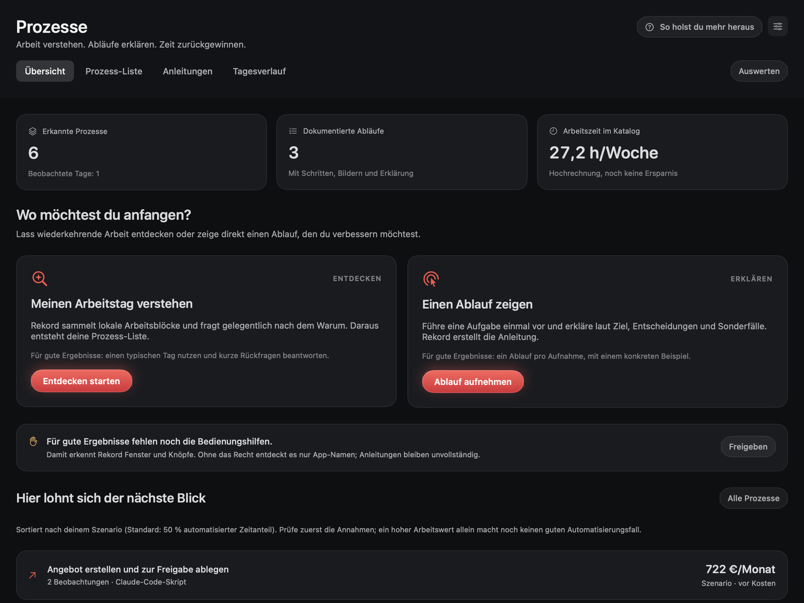

<p align="center">
  
</p>

<h3 align="center">
  <a href="https://github.com/Rekord-app/rekord/releases/latest/download/Rekord.zip">⬇&nbsp; Rekord für macOS herunterladen</a>
</h3>
<p align="center">
  Kostenlos · Mac mit Apple-Chip (M1 oder neuer) · macOS 14 oder neuer · <a href="ANLEITUNG.md">Ausführliche Anleitung</a>
</p>

## In einer Minute installiert

1. **[Rekord.zip](https://github.com/Rekord-app/rekord/releases/latest/download/Rekord.zip) herunterladen**, doppelklicken und `Rekord.app` in den Ordner **Programme** ziehen.
2. **Release-Hinweise prüfen:** Die bisher veröffentlichten Builds sind noch lokal signiert. Ein öffentlicher Launch ist erst nach Developer-ID-Signatur, Notarisierung und Prüfung auf einem frischen Mac vorgesehen. Bei einer macOS-Sicherheitswarnung die Herkunft prüfen; Details unter [Release-Prüfung](docs/RELEASE.md).
3. **Freigaben erlauben** (Bildschirmaufnahme, Kamera, Mikrofon), Rekord einmal mit **⌘Q** beenden und neu öffnen. Fertig.

**Update:** neue `Rekord.zip` laden und `Rekord.app` in „Programme“ ersetzen. Aufnahmen und Einstellungen bleiben. Beim Wechsel der Signatur können macOS-Freigaben erneut nötig sein.
**Mit Claude Code verbinden (optional):** `claude mcp add --scope user rekord -- /Applications/Rekord.app/Contents/MacOS/rekord-mcp`

<br>

## Aus einer Bildschirmaufnahme wird ein Video

Du nimmst einfach auf. Rekord legt den Bildschirm auf einen Studio-Hintergrund, rundet die Ecken, glättet den Mauszeiger und zoomt automatisch dorthin, wo du klickst.

<p align="center"></p>

<p align="center"></p>
<p align="center"><sub>Kein Keyframe gesetzt, kein Schnittprogramm geöffnet – die Zooms entstehen aus deinen Klicks.</sub></p>

<br>

## Aufnehmen und Arbeit verbessern

<table>
<tr>
<td width="50%" valign="top">

### 🎬 Studio
Für YouTube und Erklärvideos. Auto-Zoom auf Klicks, Kamera in fünf Stilen (auch Vollbild oder neben dem Bildschirm), zwölf Studio-Hintergründe, Schnitt in der Timeline, Export bis 4K60.

</td>
<td width="50%" valign="top">

### 🔗 Sofort-Link
Aufnehmen, stoppen – der Link liegt schon in der Zwischenablage. Läuft über deinen eigenen Server, Links laufen auf Wunsch nach 90 Tagen ab.

</td>
</tr>
<tr>
<td width="50%" valign="top">

### 🎙️ Meetings
Nimmt Calls nach Bestätigung auf. Automatik für Zoom, Meet, Teams und FaceTime ist standardmäßig aus und wird ausdrücklich aktiviert – ohne Bot im Call. Transkript lokal auf dem Mac, danach eine Sales-Notiz: Interesse, Schmerz, Budget, Einwände, nächster Schritt.

</td>
<td width="50%" valign="top">

### 📋 Prozesse
Arbeits-Inventur und Anleitungen in einem Bereich: wiederkehrende Arbeit entdecken, einen Ablauf vormachen, Zeitgewinn und Kosten durchrechnen und mit konkreten Belegen an Claude Code übergeben.

</td>
</tr>
</table>

<br>

### Video-Angebote
Ein eigener Link pro Interessent mit **Termin buchen** direkt unter dem Video. Nach Zustimmung siehst du gemessene Öffnungen, abgespielte Abschnitte und Terminbutton-Klicks. Die laufende Mac-App meldet die erste gemessene Öffnung. [So funktioniert es](docs/VIDEO-ANGEBOTE.md).

### Der Editor
Alles bleibt editierbar: Zooms verschieben, Schnitte setzen, Kamera umstellen, Hintergrund wechseln. Was du siehst, ist pixelgenau das spätere Video.

<p align="center"></p>

### Meetings auf einen Blick
Interesse, nächster Schritt, Budget und Entscheider stehen oben. Darunter Einwände im Wortlaut, Aufgaben und ein fertiger Follow-up-Entwurf.

<p align="center"></p>

### Anleitungen, die sich selbst schreiben
Jeder Klick wird ein Schritt mit Bild. Mustererkennung schwärzt erkannte E-Mail-Adressen, IBANs und Passwortfelder. Bilder und Texte vor dem Teilen prüfen und bei Bedarf manuell schwärzen. Anleitungslinks enthalten Texte, geschwärzte Schritt-Bilder und optional den Brief; das vollständige Video und Audio bleiben lokal.

<p align="center"></p>

<br>

## Prozesse: Entdecken → Erklären → Automatisieren



**Wiederkehrende Arbeit erkennen:** bewusst starten, lokal Arbeitsblöcke sammeln und kurze Rückfragen per Sprache oder Text beantworten. Die Inventur bleibt experimentell. Übersicht, Prozess-Liste, Anleitungen und Tagesverlauf sind jetzt zusammen. Verknüpfe eine Anleitung ausdrücklich mit ihrem Prozess; ergänze Ziel, Eingaben, Sonderfälle und Erfolgskriterien. Deine Angaben bleiben bei erneuter KI-Auswertung erhalten. „An Claude Code übergeben“ erstellt ein Paket mit Beispielen, offenen Fragen und prüfbaren Erfolgskriterien. Der Eval-Skill testet einen Entwurf mit zehn Fällen; automatischer Versand oder Aktivierung gehören nicht dazu.

- **Start:** Seitenleiste → **Prozesse** → **Entdecken starten**. Pause, Fortsetzen und Ausschlüsse jederzeit über die Menüleiste. Eigener Stundensatz, Tokenbudget, Abend-Auswertung und Aufbewahrung in den Einstellungen.
- **ROI sichtbar:** Dauer, Häufigkeit, automatisierten Anteil, menschliche Prüfung und Kosten anpassen. Rekord berechnet freie Stunden, Kapazitätswert nach Kosten, Amortisation und den modellierten ROI im ersten Jahr. Die voreingestellten 50 % sind eine Annahme, keine KI-Prognose. Unbekannte Kosten zählen nicht als null; Arbeitswert ist keine garantierte Ersparnis.
- **Mehr herausholen:** „So holst du mehr heraus“ erklärt den Ablauf in vier Schritten. Beginne mit einem klaren Prozess, erkläre Entscheidungen und einen Sonderfall; prüfe anschließend Belege und Annahmen.
- **Was den Mac verlässt:** ausschließlich maskierter Text zur Claude-API; keine Inventur-Bilder, Videos oder Sprachaufnahmen. Bilder werden lokal verkleinert/geschwärzt. Ohne Bedienungshilfen nur App-Metadaten. Mustererkennung kann vertrauliche Inhalte übersehen: Ausschlüsse vor Verwendung prüfen. [Datenschutz und Team-Nutzung](docs/inventur-datenschutz.md).
- **Ablage:** `~/Movies/Rekord/Inventur/`; Tagesordner, `prozesse.json/.md`, `Prozesse/<ID>/handover.json/.md`. Bilder standardmäßig 7 Tage, Rohproben 30 Tage. Kein Inventur-Upload an den Share-Server.
- **Befehle:** `rekord://inventory`, `rekord://inventory-pause?minutes=15`, `rekord://inventory-resume`. **MCP:** `inventory_status`, `list_processes`, `get_process`, `get_inventory_day` ([Beispiele](docs/MCP.md)).
- **Team:** eigene Einwilligung, sichtbares Symbol, jederzeit Pause; nur einzeln geprüfte, editierbare Prozesse im lokalen Export. Keine Zeitachse, Bilder oder Rohproben im Export.
- **Abnahme:** `--inventory-replay <Ordner>` verwendet ausschließlich die Fake-Fixture; `--inventory-check <Ordner>` ist der kontrollierte 10-Minuten-Lauf nach Freigabe. Ergebnis: 6/6 Prozesse, zehn Eval-Fälle mit 9,80/10, 28.267 Tokens für den Fixture-Tag. Echte Live-Abnahme und ein echter Arbeitstag stehen noch aus. [Messwerte und Grenzen](docs/validation/inventory/acceptance.md).

## Steuerbar per Claude Code

Rekord bringt einen MCP-Server mit. Damit erledigt Claude Code die Arbeit, für die du sonst klicken würdest:

```text
„Nimm 30 Sekunden im 16:9-Bereich auf und stopp dann.“
„Entferne alle Zooms außer dem zweiten, Hintergrund Blaue Stunde, exportier 4K60.“
„Kamera als Hochkant-Kachel, die ersten 3 Sekunden Vollbild, dann teile den Link.“
„Welche Calls von heute hatten Interesse ab 4? Schreib mir die Follow-ups.“
„Hol die drei teuersten automatisierbaren Prozesse aus meiner Inventur und bau den ersten als Entwurf.“
```

Alle Werkzeuge: [docs/MCP.md](docs/MCP.md) · [Datenschutz](docs/PRIVACY.md) · [Mitwirken](CONTRIBUTING.md) · [Sicherheit melden](SECURITY.md)

<br>

## Voraussetzungen und Kosten

| Funktion | Voraussetzung | Kosten |
|---|---|---|
| Studio, Schnitt, Export, lokale Anleitungen | macOS 14+, Apple-Chip | App kostenlos |
| Meeting-Mikrofon und Systemton | macOS 14.2+ | lokal, kostenlos |
| Lokale Transkription | macOS 26+, unterstützte Apple-Spracherkennung; Sprachmodell ggf. einmal laden | keine API-Kosten |
| Claude-Notizen, Texte, Brief, Inventur-Auswertung | eigener Anthropic-API-Schlüssel | API-Verbrauch nach deinem Tarif |
| Teilen per Link | eigener HTTPS-Share-Server | Hosting, Speicher und Traffic |
| Selbst bauen | macOS SDK 26+ / Xcode 26+ | lokale Entwicklungswerkzeuge |

Ohne API-Schlüssel bleiben Aufnahme, lokale Dateien, Export und verfügbare lokale Transkription nutzbar. Ohne Share-Server bleiben lokale Exporte nutzbar. Die Inventur ist noch nicht mit einem echten Arbeitstag abgenommen.

## Privat gebaut

- **Alles lokal:** Aufnahmen, Schnitt, Export und Transkripte bleiben auf deinem Mac.
- **Kein fremder Cloud-Dienst:** Links laufen über deinen eigenen kleinen Server ([share-service](share-service/README.md), Docker oder Node). Ohne Server funktioniert alles andere trotzdem.
- **KI nur, wenn du willst:** Für Meeting-Notizen, Anleitungstexte und die Arbeits-Inventur schickt Rekord **nur Text** an Claude – mit deinem eigenen Schlüssel.
- **Deine Originale sind geschützt:** Kein Export kann eine Aufnahme überschreiben. Stürzt etwas ab, rettet Rekord den Take beim nächsten Start.

<br>

## Für Entwickler

```sh
git clone https://github.com/Rekord-app/rekord.git && cd rekord
./scripts/install.sh      # baut, installiert nach ~/Applications, verbindet Claude Code
./scripts/test.sh         # Tests
```

Swift/SwiftUI, ScreenCaptureKit, AVFoundation, Core Image – ohne externe Abhängigkeiten. Aufbau, Modi im Detail, Speicher, Tests: **[docs/TECHNIK.md](docs/TECHNIK.md)** · Neuerungen: **[CHANGELOG.md](CHANGELOG.md)**

<br>

## Lizenz

**Source-available, derzeit kein uneingeschränktes Open Source:** Die aktuelle FSL beschränkt kommerzielle Konkurrenz. Kostenlos nutzbar bedeutet nicht automatisch Open Source.

[Functional Source License 1.1](LICENSE.md) (FSL-1.1-ALv2): Nutzen, anpassen, intern und für Kundenprojekte einsetzen – frei. Nur ein konkurrierendes kommerzielles Produkt daraus zu machen ist nicht erlaubt. Jede Version wird zwei Jahre nach Erscheinen automatisch Apache-2.0. Name und Logo „Rekord“ sind nicht Teil der Lizenz.

<p align="center"><sub>Gebaut von <a href="https://github.com/NikitaSapunov">Nikita Sapunov</a>.</sub></p>
