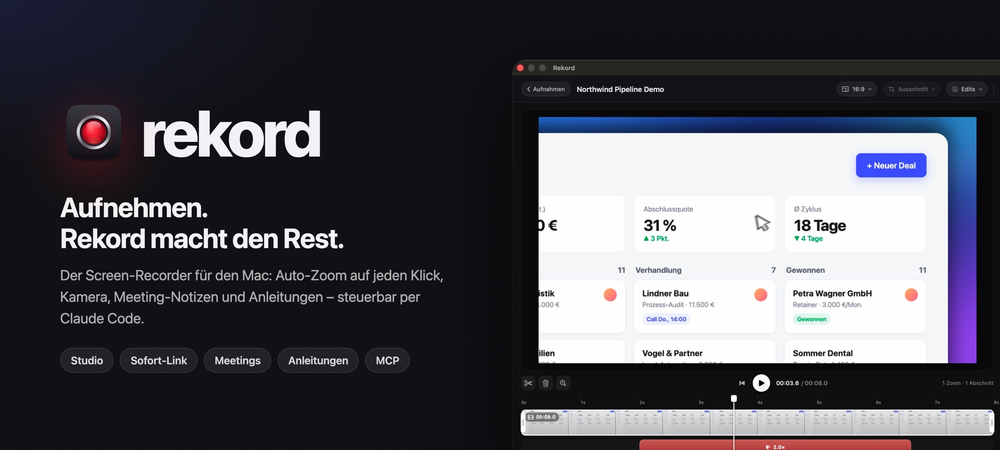
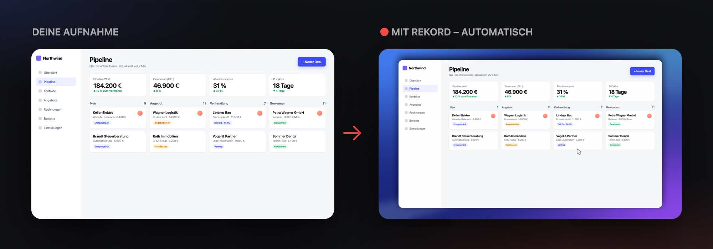
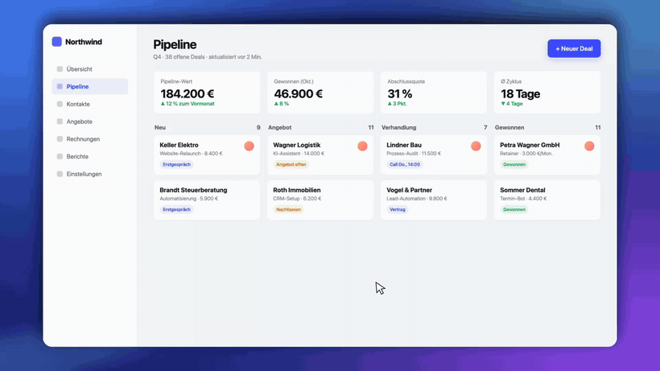
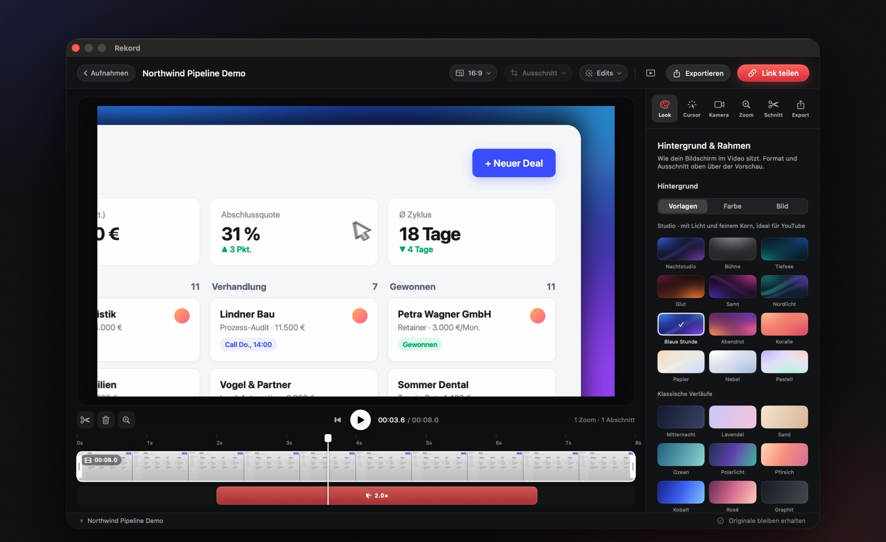
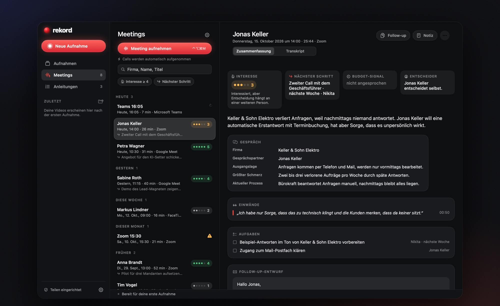
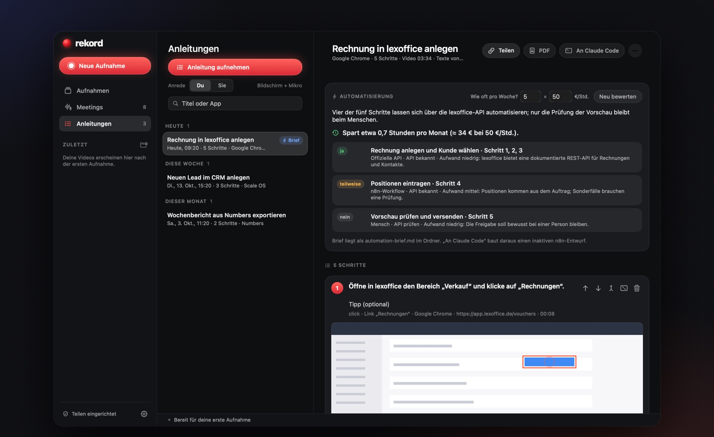

<p align="center">
  
</p>

<h3 align="center">
  <a href="https://github.com/Rekord-app/rekord/releases/latest/download/Rekord.zip">⬇&nbsp; Rekord für macOS herunterladen</a>
</h3>
<p align="center">
  Kostenlos · Mac mit Apple-Chip (M1 oder neuer) · macOS 14 oder neuer · <a href="ANLEITUNG.md">Ausführliche Anleitung</a>
</p>

## In einer Minute installiert

1. **[Rekord.zip](https://github.com/Rekord-app/rekord/releases/latest/download/Rekord.zip) herunterladen**, doppelklicken und `Rekord.app` in den Ordner **Programme** ziehen.
2. **Beim ersten Öffnen** meldet macOS, dass die App blockiert wurde: **Systemeinstellungen → Datenschutz & Sicherheit →** ganz unten **Dennoch öffnen**.
   <sub>Oder im Terminal: `xattr -dr com.apple.quarantine /Applications/Rekord.app`. Grund: Rekord ist noch nicht über eine bezahlte Apple Developer ID signiert.</sub>
3. **Freigaben erlauben** (Bildschirmaufnahme, Kamera, Mikrofon), Rekord einmal mit **⌘Q** beenden und neu öffnen. Fertig.

**Update:** neue `Rekord.zip` laden und `Rekord.app` in „Programme“ ersetzen. Aufnahmen, Freigaben und Einstellungen bleiben.
**Mit Claude Code verbinden (optional):** `claude mcp add --scope user rekord -- /Applications/Rekord.app/Contents/MacOS/rekord-mcp`

<br>

## Aus einer Bildschirmaufnahme wird ein Video

Du nimmst einfach auf. Rekord legt den Bildschirm auf einen Studio-Hintergrund, rundet die Ecken, glättet den Mauszeiger und zoomt automatisch dorthin, wo du klickst.

<p align="center"></p>

<p align="center"></p>
<p align="center"><sub>Kein Keyframe gesetzt, kein Schnittprogramm geöffnet – die Zooms entstehen aus deinen Klicks.</sub></p>

<br>

## Vier Modi, eine App

<table>
<tr>
<td width="50%" valign="top">

### 🎬 Studio
Für YouTube und Erklärvideos. Auto-Zoom auf Klicks, Kamera in fünf Stilen (auch Vollbild oder neben dem Bildschirm), zwölf Studio-Hintergründe, Schnitt in der Timeline, Export bis 4K60.

</td>
<td width="50%" valign="top">

### 🔗 Sofort-Link
Aufnehmen, stoppen – der Link liegt schon in der Zwischenablage. Läuft über deinen eigenen Server, Links laufen auf Wunsch nach 90 Tagen ab.

</td>
</tr>
<tr>
<td width="50%" valign="top">

### 🎙️ Meetings
Nimmt Calls in Zoom, Meet, Teams und FaceTime automatisch auf – ohne Bot im Call. Transkript lokal auf dem Mac, danach eine Sales-Notiz: Interesse, Schmerz, Budget, Einwände, nächster Schritt.

</td>
<td width="50%" valign="top">

### 📋 Anleitungen
Ablauf einmal vormachen und erklären – Rekord schreibt die Schritt-für-Schritt-Anleitung mit Screenshots. Als PDF, Markdown oder Link. Plus: Was davon sich automatisieren lässt.

</td>
</tr>
</table>

<br>

### Der Editor
Alles bleibt editierbar: Zooms verschieben, Schnitte setzen, Kamera umstellen, Hintergrund wechseln. Was du siehst, ist pixelgenau das spätere Video.

<p align="center"></p>

### Meetings auf einen Blick
Interesse, nächster Schritt, Budget und Entscheider stehen oben. Darunter Einwände im Wortlaut, Aufgaben und ein fertiger Follow-up-Entwurf.

<p align="center"></p>

### Anleitungen, die sich selbst schreiben
Jeder Klick wird ein Schritt mit Bild. E-Mail-Adressen, IBANs und Passwortfelder werden automatisch geschwärzt.

<p align="center"></p>

<br>

## Steuerbar per Claude Code

Rekord bringt einen MCP-Server mit. Damit erledigt Claude Code die Arbeit, für die du sonst klicken würdest:

```text
„Nimm 30 Sekunden im 16:9-Bereich auf und stopp dann.“
„Entferne alle Zooms außer dem zweiten, Hintergrund Blaue Stunde, exportier 4K60.“
„Kamera als Hochkant-Kachel, die ersten 3 Sekunden Vollbild, dann teile den Link.“
„Welche Calls von heute hatten Interesse ab 4? Schreib mir die Follow-ups.“
```

Alle Werkzeuge: [docs/MCP.md](docs/MCP.md)

<br>

## Privat gebaut

- **Alles lokal:** Aufnahmen, Schnitt, Export und Transkripte bleiben auf deinem Mac.
- **Kein fremder Cloud-Dienst:** Links laufen über deinen eigenen kleinen Server ([share-service](share-service/README.md), Docker oder Node). Ohne Server funktioniert alles andere trotzdem.
- **KI nur, wenn du willst:** Für Meeting-Notizen und Anleitungstexte schickt Rekord **nur Text** an Claude – mit deinem eigenen Schlüssel.
- **Deine Originale sind geschützt:** Kein Export kann eine Aufnahme überschreiben. Stürzt etwas ab, rettet Rekord den Take beim nächsten Start.

<br>

## Für Entwickler

```sh
git clone https://github.com/Rekord-app/rekord.git && cd rekord
./scripts/install.sh      # baut, installiert nach ~/Applications, verbindet Claude Code
./scripts/test.sh         # Tests
```

Swift/SwiftUI, ScreenCaptureKit, AVFoundation, Core Image – ohne externe Abhängigkeiten. Aufbau, Modi im Detail, Speicher, Tests: **[docs/TECHNIK.md](docs/TECHNIK.md)** · Neuerungen: **[CHANGELOG.md](CHANGELOG.md)**

<br>

## Lizenz

[Functional Source License 1.1](LICENSE.md) (FSL-1.1-ALv2): Nutzen, anpassen, intern und für Kundenprojekte einsetzen – frei. Nur ein konkurrierendes kommerzielles Produkt daraus zu machen ist nicht erlaubt. Jede Version wird zwei Jahre nach Erscheinen automatisch Apache-2.0. Name und Logo „Rekord“ sind nicht Teil der Lizenz.

<p align="center"><sub>Gebaut von <a href="https://github.com/NikitaSapunov">Nikita Sapunov</a>.</sub></p>
