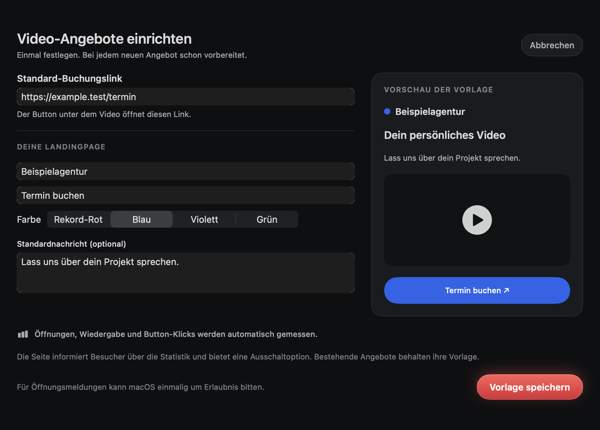
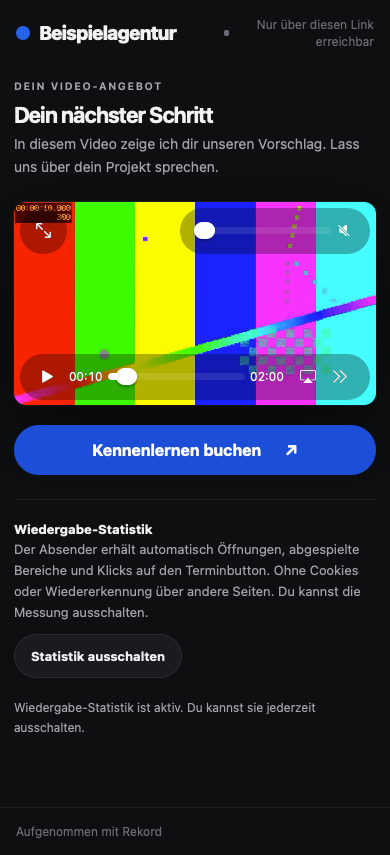

# Offer setup and automatic statistics — 2026-10-15

Rekord 1.12.0 (15). Synthetic media and booking destinations only.

- Release app and MCP build: pass; strict local signature verification: pass.
- Core tests: pass, including automatic defaults, migration of the existing booking URL, template snapshots, validation and preservation after an invalid save.
- Native URLSession lifecycle: pass on loopback and public HTTPS, including automatic session creation, custom sender, editing, expiry, reset, revoke, ordinary videos and guide lifecycle.
- Node service: 31/31 groups pass locally and on production Node 22. New coverage includes escaped template fields, allowlisted colors, mode validation, persistent automatic measurements without a fabricated consent record, restart and legacy compatibility.
- Chrome and WebKit: automatic opening without interaction, playback coverage, CTA, desktop/390px layout, no cookies or automatically persisted session identifiers, fresh sessions on reload, opt-out across reload, GPC, no JavaScript, preview and stop during an in-flight start: pass.
- Existing consent-mode acceptance: pass in Chrome and WebKit, including 25%/50% played, seek/replay, reload and withdrawal.
- Native diagnostics: first opening arrives after 15 seconds; activity survives recreated stores; navigation and setup/form/detail snapshots pass. OS notification banner skipped because permission is not granted; no permission was silently granted.
- Public HTTPS browser acceptance: automatic opening, branded page, actual playback, opt-out deletion pass. Synthetic media revoked afterward; no booking submitted.
- Release/publisher guards: pass (stale public HEAD, community edits, source/build drift, legacy export baseline and outgoing private-content scan).

The automatic mode counts page sessions, including reloads, rather than unique people. Existing offers keep consent mode until deliberately changed. Physical iPhone testing remains separate; 390px WebKit is a viewport test.

The installed build exposed a pre-existing main-thread keychain wait during background polling. Share credential reads now run off the main actor; settings, offers, ordinary video sharing and guide sharing await them. The system authorization itself is unchanged.
